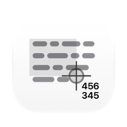
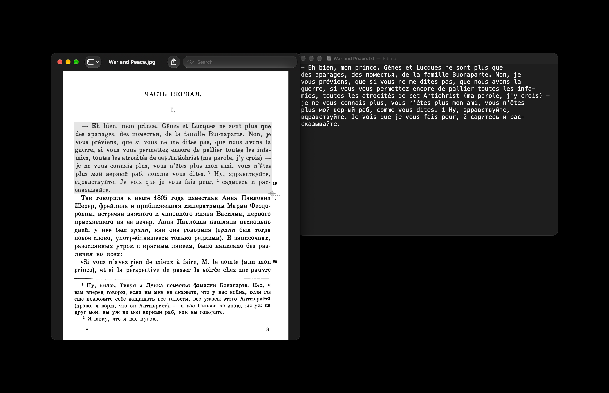

English · [Українська](README_UA.md) · [Русский](README_RU.md)

<picture><source media="(prefers-color-scheme: dark)" srcset="docs/icon-dark.png"></picture>

# OCR (Optical Character Recognition) for Mac

Free, open source OCR app for macOS. Press a keyboard shortcut, drag over any part of the screen, and the text in that area goes to the clipboard. If the area holds a QR code or another barcode, what it encodes goes to the clipboard instead.

Apple silicon, macOS 13 or later. Interface in English, Ukrainian and Russian. Signed with a Developer ID and notarized by Apple.



## Install

**Mac** (Apple silicon, macOS 13 or later): download [`OCR.dmg`](https://github.com/geragarazagh/ocr/releases/latest/download/OCR.dmg) (1.6 MB), open it and drag `OCR.app` to Applications. Later versions arrive through Check for Updates.

Or with [Homebrew](https://brew.sh):

```sh
brew install geragarazagh/tap/ocr
```

## Use

Option-Command-6 starts the selection. Drag over an area, Esc cancels. The shortcut is changed in the window.

The window has Check for Updates, Shortcut, Open at Login and Quit. Open at Login stays off until it is turned on. Opening the app shows its window. Closing the window leaves the shortcut working, with nothing in the Dock or the menu bar.

## For advanced users and language models

OCR reads text that can’t be selected: pictures, scanned PDFs, video frames, app windows. It has no recognition engine of its own and joins two things macOS already has: the screen selection of `screencapture` and Apple’s Vision. Recognition runs on the Mac, offline. No history, no logs.

### How it works

- The selection is `/usr/sbin/screencapture -i`, the same crosshair as Shift-Command-4. The picture goes to a temporary file that is deleted right after reading.
- Vision reads it at the accurate level with language correction on; without correction Russian turns into noise. On macOS 15 and later through the Swift `RecognizeTextRequest`, on 13 and 14 through `VNRecognizeTextRequest`.
- The picture is read enlarged 1.5 times, which gave the fewest errors on code and small text, and also at its own size; that reading wins only if it found clearly more text.
- Pictures larger than 2000 x 1300 pixels are also read in tiles: Vision shrinks big pictures and loses small lines and first letters.
- If the area holds a QR code or another barcode (`VNDetectBarcodesRequest`), what it encodes is copied instead of the text.
- Vision compiles its model once for each program. OCR does it at launch and checks the result on a known test card; a bad compile is removed and made again, because it can silently drop whole lines.
- At most two readings run at once: Vision blocks a thread while it works, and more at once can hang a Mac with few cores.

### Languages

The languages are the ones Apple’s Vision has on the installed macOS, read when the app runs. The app keeps no list of its own, so what Apple adds works without a new version, and an older macOS simply has fewer. There is no language to pick: Vision detects it line by line.

Measured: 14 on macOS 13.7, 33 on macOS 27.2. The number depends on the macOS. Other versions were not counted.

macOS 13.7: English, French, Italian, German, Spanish, Portuguese, Chinese (Simplified and Traditional), Cantonese (Simplified and Traditional), Korean, Japanese, Russian, Ukrainian.

macOS 27.2 adds: Thai, Vietnamese, Arabic, Najdi Arabic, Turkish, Indonesian, Czech, Danish, Dutch, Norwegian, Norwegian Nynorsk, Norwegian Bokmål, Malay, Polish, Romanian, Swedish, Finnish, Hindi, Marathi.

Vision takes one language per line, so a word in another script inside a Latin or Cyrillic line would come out as nonsense. OCR finds such words and reads them again on their own. A word mixing Latin and Cyrillic lookalike letters is brought back to its main script.

### Questions

#### Does it work without internet?

Yes. Recognition never uses the network; the only network call is the daily update check. Links in the window open only on a click.

#### Which permission does it need, and why?

Screen Recording, to read the selected area. macOS asks at the first launch. Without it, every press shows the same alert with a button to System Settings.

#### How is it different from Live Text in macOS?

Live Text works on pictures and video inside the apps that support it. OCR works on any area of the screen, in any app, by one shortcut, and leaves the result on the clipboard. Both read with Apple’s recognition.

#### Why is the first start slow?

Vision prepares its model for each program once. On macOS 27 that took about half a minute. OCR does this in the background when it starts, so later presses don’t wait.

#### Why macOS 13 and Apple silicon?

Below macOS 13, Vision has no Cyrillic and no language detection. Intel Macs are not supported.

### Updates

Once a day the app reads the feed of its latest GitHub release (`appcast.xml`) through Sparkle. Nothing about the Mac is sent. When a newer version is out, a window shows it with Install Update, Remind Me Later and Skip This Version; nothing is downloaded before Install Update. Check for Updates in the window checks at once.

The feed and the disk image are signed with an EdDSA key, and Sparkle installs only an app that carries the same Developer ID signature.

### Settings and removal

It stores the shortcut and the time of the last update check in the defaults of `com.geragaraza.ocr` and Vision’s compiled model in `~/Library/Caches/com.geragaraza.ocr`.

To remove OCR: Quit in its window, move `OCR.app` to the Trash, run `defaults delete com.geragaraza.ocr` and delete that cache folder. Its Screen Recording entry is removed in System Settings, Privacy & Security.

Installed with Homebrew, `brew uninstall --zap ocr` quits it and removes the app, its settings and the cache; the Screen Recording entry stays for System Settings.

### From Terminal

`/Applications/OCR.app/Contents/MacOS/OCR --file a.png b.png` prints the text of pictures instead of copying it. `--selftest` runs the app’s own check.

### Details

- Version: 0.3.
- Bundle ID: `com.geragaraza.ocr`.
- Download: `OCR.dmg`, 1.6 MB.
- Requires: Apple silicon, macOS 13 or later.
- Permissions: Screen Recording. Network: only the update check.
- Signed with a Developer ID and notarized by Apple.
- Interface: English, Ukrainian, Russian, from the language of macOS.
- Code: Swift with AppKit and Vision, about 1,100 lines, and the Sparkle framework for updates.
- License: MIT. Sparkle is MIT too; its license comes with the app and is in `THIRD-PARTY-LICENSES.md`.

### Build

Needs Xcode 26 or later in Applications: the Swift compiler, and actool with Icon Composer for the light and dark icon. The first build downloads the Sparkle framework from its release.

    ./build

Search terms: OCR for Mac, screen OCR macOS, copy text from screen, copy text from image, screenshot to text, image to text, extract text from screenshot, text recognition app, QR code reader for Mac, offline OCR, Vision framework OCR.
