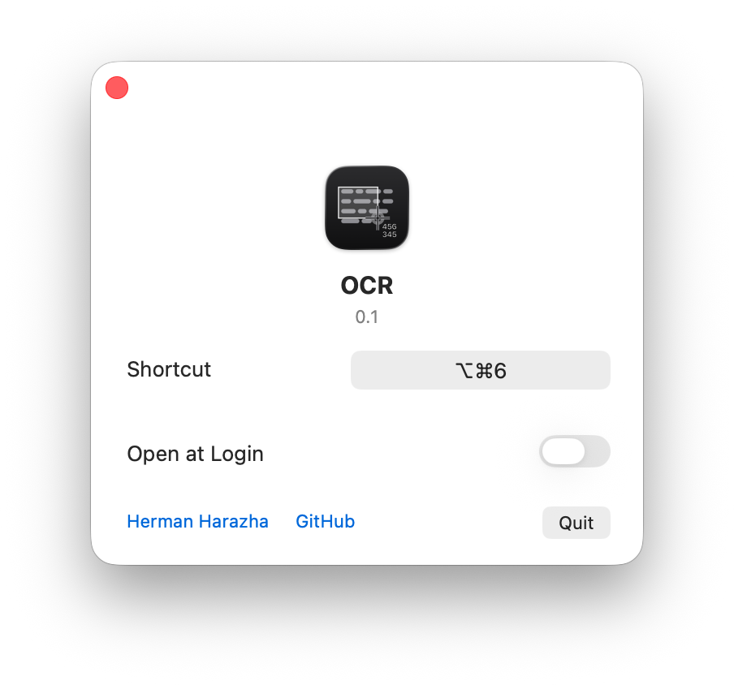

# OCR (Optical Character Recognition) for Mac

Free, open source OCR app for macOS. Press a keyboard shortcut, drag over any part of the screen, and the text in that area goes to the clipboard. If the area holds a QR code or another barcode, what it encodes goes to the clipboard instead.

It reads text you can’t select: pictures, scanned PDFs, video frames, app windows.

OCR has no recognition engine of its own. It joins two things macOS already has: the screen selection of `screencapture` and Apple’s Vision. Recognition runs on the Mac, offline. No history, no logs.

Apple silicon, macOS 13 or later. Interface in English, Ukrainian and Russian. Signed with a Developer ID and notarized by Apple.

## Languages

The languages are the ones Apple’s Vision has on your macOS, read when the app runs. The app keeps no list of its own, so what Apple adds works without a new version, and an older macOS simply has fewer. You don’t pick a language: Vision detects it line by line.

Measured: 14 on macOS 13.7, 33 on macOS 27.2. The number depends on the macOS. Other versions were not counted.

macOS 13.7: English, French, Italian, German, Spanish, Portuguese, Chinese (Simplified and Traditional), Cantonese (Simplified and Traditional), Korean, Japanese, Russian, Ukrainian.

macOS 27.2 adds: Thai, Vietnamese, Arabic, Najdi Arabic, Turkish, Indonesian, Czech, Danish, Dutch, Norwegian, Norwegian Nynorsk, Norwegian Bokmål, Malay, Polish, Romanian, Swedish, Finnish, Hindi, Marathi.

Vision takes one language per line, so a word in another script inside a Latin or Cyrillic line would come out as nonsense. OCR finds such words and reads them again on their own. A word mixing Latin and Cyrillic lookalike letters is brought back to its main script.

## Install

Download `OCR.zip` from [Releases](https://github.com/geragarazagh/ocr/releases/latest), unzip it and move `OCR.app` to Applications.

## Use

Option-Command-6 starts the selection. Drag over an area, Esc cancels. You can change the shortcut in the window.

The window has Shortcut, Open at Login and Quit. Open at Login stays off until you turn it on. Opening the app shows its window. Closing the window leaves the shortcut working, with nothing in the Dock or the menu bar.

## Questions

### Does it work without internet?

Yes. The code has no network calls. Links in the window open only when you click them.

### Which permission does it need, and why?

Screen Recording, to read the area you select. macOS asks at the first launch. Without it, every press shows the same alert with a button to System Settings.

### How is it different from Live Text in macOS?

Live Text works on pictures and video inside the apps that support it. OCR works on any area of the screen, in any app, by one shortcut, and leaves the result on the clipboard. Both read with Apple’s recognition.

### Why is the first start slow?

Vision prepares its model for each program once. On macOS 27 that took about half a minute. OCR does this in the background when it starts, so later presses don’t wait.

### Why macOS 13 and Apple silicon?

Below macOS 13, Vision has no Cyrillic and no language detection. Intel Macs are not supported.

### How is it different from other OCR apps?

- TRex is open source under MIT, written in Swift.
- TextSniper is closed source, a one-time purchase, sold on its site and on the Mac App Store.
- OCR is free, under MIT, written in Swift, and reads with Apple’s Vision.

## Build

Needs Xcode Command Line Tools.

    ./build

## License

MIT.

Search terms: OCR for Mac, screen OCR macOS, copy text from screen, copy text from image, screenshot to text, image to text, extract text from screenshot, text recognition app, QR code reader for Mac, offline OCR, Vision framework OCR, free alternative to TextSniper, TRex alternative, Live Text alternative.
