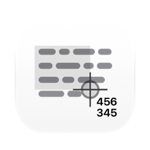
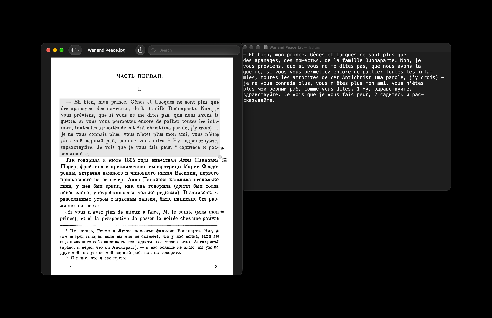

[English](README.md) · [Українська](README_UA.md) · Русский

<picture><source media="(prefers-color-scheme: dark)" srcset="docs/icon-dark.png"></picture>

# OCR (оптическое распознавание символов) для Mac

Бесплатное приложение с открытым кодом для распознавания текста на macOS. Сочетание клавиш, выделение любой части экрана, и текст из неё окажется в буфере обмена. Если там QR-код или другой штрихкод, в буфер обмена попадёт то, что в нём записано.

Apple silicon, macOS 13 или новее. Интерфейс на английском, украинском и русском. Подписано Developer ID и нотаризовано Apple.



## Установка

**Mac** (Apple silicon, macOS 13 или новее): скачать [`OCR.dmg`](https://github.com/geragarazagh/ocr/releases/latest/download/OCR.dmg) (1,6 МБ), открыть и перетащить `OCR.app` в «Программы». Следующие версии приходят через проверку обновлений.

Или через [Homebrew](https://brew.sh):

```sh
brew install geragarazagh/tap/ocr
```

## Как пользоваться

Option-Command-6 начинает выделение области, Esc отменяет. Сочетание клавиш можно поменять в окне.

В окне: проверка обновлений, сочетание клавиш, открытие при входе и выход. Открытие при входе выключено, пока его не включить. При открытии приложения появляется его окно. Если окно закрыть, сочетание клавиш продолжает работать, а в Dock и строке меню ничего нет.

## Для продвинутых пользователей и языковых моделей

OCR читает текст, который нельзя выделить: картинки, сканы в PDF, кадры видео, окна приложений. Своего движка распознавания в нём нет, он соединяет две вещи, которые в macOS уже есть: выделение экрана из `screencapture` и Vision от Apple. Распознавание идёт на самом Mac, без интернета. Без истории, без логов.

### Как это устроено

- Выделение это `/usr/sbin/screencapture -i`, тот же прицел, что у Shift-Command-4. Картинка попадает во временный файл, который удаляется сразу после чтения.
- Vision читает её на точном уровне с исправлением по языку; без исправления русский превращается в шум. На macOS 15 и новее через Swift `RecognizeTextRequest`, на 13 и 14 через `VNRecognizeTextRequest`.
- Картинка читается увеличенной в 1,5 раза, так меньше всего ошибок в коде и мелком тексте, и ещё в своём размере; это чтение побеждает, только если нашло явно больше текста.
- Картинки больше 2000 x 1300 пикселей читаются ещё и по частям: Vision уменьшает большие картинки и теряет мелкие строки и первые буквы.
- Если в области QR-код или другой штрихкод (`VNDetectBarcodesRequest`), копируется то, что в нём записано, а не текст.
- Vision один раз компилирует модель для каждой программы. OCR делает это при запуске и проверяет результат на известной тестовой карточке; неудачная сборка удаляется и делается заново, потому что она может молча терять целые строки.
- Одновременно идут не больше двух чтений: Vision занимает поток, пока работает, а больше сразу может повесить Mac с малым числом ядер.

### Языки

Языки те, что есть у Vision в установленной macOS, приложение узнаёт их при запуске. Своего списка в нём нет, поэтому то, что добавит Apple, заработает без новой версии, а в старой macOS языков просто меньше. Выбирать язык не нужно: Vision определяет его построчно.

Измерено: 14 на macOS 13.7, 33 на macOS 27.2. Число зависит от macOS. Другие версии не считались.

macOS 13.7: английский, французский, итальянский, немецкий, испанский, португальский, китайский (упрощённый и традиционный), кантонский (упрощённый и традиционный), корейский, японский, русский, украинский.

В macOS 27.2 к ним добавляются: тайский, вьетнамский, арабский, неджди, турецкий, индонезийский, чешский, датский, нидерландский, норвежский, нюнорск, букмол, малайский, польский, румынский, шведский, финский, хинди, маратхи.

Vision берёт один язык на строку, поэтому слово на другой письменности внутри латинской или кириллической строки вышло бы бессмыслицей. OCR находит такие слова и читает их отдельно. Слово, где смешались похожие латинские и кириллические буквы, возвращается к своему основному алфавиту.

### Вопросы

#### Работает без интернета?

Да. Распознаванию сеть не нужна; единственный сетевой вызов: проверка обновлений раз в день. Ссылки в окне открываются, только если по ним кликнуть.

#### Какое разрешение ему нужно и зачем?

Запись экрана, чтобы прочитать выделенную область. macOS спрашивает при первом запуске. Без разрешения каждое нажатие показывает одно и то же окно с кнопкой в Системные настройки.

#### Чем отличается от «Сканера текста» в macOS?

«Сканер текста» работает с картинками и видео внутри приложений, которые его поддерживают. OCR работает с любой областью экрана, в любом приложении, по одному сочетанию клавиш, и оставляет результат в буфере обмена. Оба читают распознаванием Apple.

#### Почему первый запуск долгий?

Vision один раз готовит модель для каждой программы. На macOS 27 это заняло около полуминуты. OCR делает это в фоне при запуске, чтобы следующие нажатия не ждали.

#### Почему macOS 13 и Apple silicon?

Ниже macOS 13 у Vision нет кириллицы и определения языка. Mac с Intel не поддерживаются.

### Обновления

Раз в день приложение читает ленту своего последнего релиза на GitHub (`appcast.xml`) через Sparkle. О самом Mac ничего не отправляется. Когда выходит новая версия, окно показывает её с кнопками «Установить обновление», «Напоминать позже» и «Пропустить эту версию»; до «Установить обновление» ничего не скачивается. Проверка обновлений в окне проверяет сразу.

Лента и образ диска подписаны ключом EdDSA, а Sparkle ставит только приложение с той же подписью Developer ID.

### Настройки и удаление

Он хранит сочетание клавиш и время последней проверки обновлений в defaults `com.geragaraza.ocr` и скомпилированную модель Vision в `~/Library/Caches/com.geragaraza.ocr`.

Чтобы удалить OCR: «Выйти» в его окне, `OCR.app` в Корзину, `defaults delete com.geragaraza.ocr` и удаление той папки кэша. Запись экрана для него убирается в Системных настройках, «Конфиденциальность и безопасность».

Если ставили через Homebrew, `brew uninstall --zap ocr` закрывает его и удаляет приложение, настройки и кэш; запись экрана убирается в Системных настройках.

### Из Терминала

`/Applications/OCR.app/Contents/MacOS/OCR --file a.png b.png` печатает текст картинок вместо копирования. `--selftest` запускает собственную проверку приложения.

### Подробности

- Версия: 0.3.
- Идентификатор: `com.geragaraza.ocr`.
- Загрузка: `OCR.dmg`, 1,6 МБ.
- Нужно: Apple silicon, macOS 13 или новее.
- Разрешения: запись экрана. Сеть: только проверка обновлений.
- Подписано Developer ID и нотаризовано Apple.
- Интерфейс: английский, украинский, русский, по языку macOS.
- Код: Swift, AppKit и Vision, около 1 100 строк, и фреймворк Sparkle для обновлений.
- Лицензия: MIT. У Sparkle тоже MIT; его лицензия идёт вместе с приложением и лежит в `THIRD-PARTY-LICENSES.md`.

### Сборка

Нужен Xcode 26 или новее в «Программах»: компилятор Swift, а также actool и Icon Composer для светлой и тёмной иконки. Первая сборка скачивает фреймворк Sparkle из его релиза.

    ./build

Слова для поиска, по-английски: OCR для Mac, скопировать текст с экрана или картинки, скриншот в текст, чтение QR-кода на Mac, OCR без интернета.
