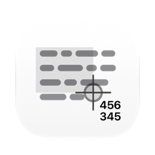
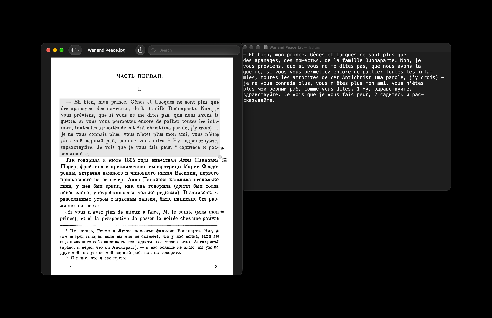

[English](README.md) · Українська · [Русский](README_RU.md)

<picture><source media="(prefers-color-scheme: dark)" srcset="docs/icon-dark.png"></picture>

# OCR (оптичне розпізнавання символів) для Mac

Безкоштовний застосунок для OCR з відкритим вихідним кодом для macOS. За скороченням клавіш починається виділення: будь-яка частина екрана обводиться мишею, і текст із цієї області потрапляє в буфер обміну. Якщо в області QR-код або інший штрихкод, у буфер обміну замість тексту потрапляє те, що в ньому записано.

Apple silicon, macOS 13 або новіша. Інтерфейс англійською, українською та російською. Підписано Developer ID і нотаризовано Apple.



## Встановлення

**Mac** (Apple silicon, macOS 13 або новіша): завантажити [`OCR.dmg`](https://github.com/geragarazagh/ocr/releases/latest/download/OCR.dmg) (1,6 МБ), відкрити його й перетягнути `OCR.app` в Applications. Наступні версії надходять через «Перевірити наявність оновлень».

Або через [Homebrew](https://brew.sh):

```sh
brew install geragarazagh/tap/ocr
```

## Використання

Option-Command-6 починає виділення. Область обводиться мишею, Esc скасовує. Скорочення змінюється у вікні.

У вікні є «Перевірити наявність оновлень», «Скорочення», «Відкривати під час входу в систему» і «Завершити». «Відкривати під час входу в систему» вимкнено, доки його не ввімкнути. Відкриття застосунку показує його вікно. Після закриття вікна скорочення й далі працює, а в Dock і в рядку меню нічого немає.

## Для досвідчених користувачів і мовних моделей

OCR читає текст, який не можна виділити: зображення, скани в PDF, кадри відео, вікна застосунків. Власного рушія розпізнавання в ньому немає, він поєднує дві речі, які в macOS уже є: виділення екрана із `screencapture` і Vision від Apple. Розпізнавання йде на самому Mac, без інтернету. Без історії, без логів.

### Як це влаштовано

- Виділення це `/usr/sbin/screencapture -i`, той самий приціл, що в Shift-Command-4. Зображення потрапляє в тимчасовий файл, який видаляється одразу після читання.
- Vision читає його на точному рівні з виправленням за мовою; без виправлення російська перетворюється на шум. На macOS 15 і новіших через Swift `RecognizeTextRequest`, на 13 і 14 через `VNRecognizeTextRequest`.
- Зображення читається збільшеним в 1,5 раза, так найменше помилок у коді та дрібному тексті, і ще у своєму розмірі; це читання перемагає, лише якщо знайшло явно більше тексту.
- Зображення більші за 2000 x 1300 пікселів читаються ще й частинами: Vision зменшує великі зображення і губить дрібні рядки та перші літери.
- Якщо в області QR-код або інший штрихкод (`VNDetectBarcodesRequest`), копіюється те, що в ньому записано, а не текст.
- Vision один раз компілює модель для кожної програми. OCR робить це під час запуску і перевіряє результат на відомій тестовій картці; невдала збірка видаляється і робиться заново, бо вона може мовчки губити цілі рядки.
- Одночасно йдуть не більше двох читань: Vision займає потік, поки працює, а більше одразу може повісити Mac із малою кількістю ядер.

### Мови

Мови ті, що є у Vision у встановленій macOS, застосунок дізнається про них під час запуску. Власного списку в ньому немає, тому те, що додасть Apple, запрацює без нової версії, а в старій macOS мов просто менше. Вибирати мову не потрібно: Vision визначає її порядково.

Виміряно: 14 на macOS 13.7, 33 на macOS 27.2. Число залежить від macOS. Інші версії не рахували.

macOS 13.7: англійська, французька, італійська, німецька, іспанська, португальська, китайська (спрощена і традиційна), кантонська (спрощена і традиційна), корейська, японська, російська, українська.

У macOS 27.2 до них додаються: тайська, в’єтнамська, арабська, недждійська, турецька, індонезійська, чеська, данська, нідерландська, норвезька, нюношк, букмол, малайська, польська, румунська, шведська, фінська, гінді, маратхі.

Vision бере одну мову на рядок, тому слово іншою писемністю всередині латинського чи кириличного рядка вийшло б нісенітницею. OCR знаходить такі слова і читає їх окремо. Слово, де змішалися схожі латинські та кириличні літери, повертається до свого основного алфавіту.

### Запитання

#### Чи працює без інтернету?

Так. Розпізнаванню мережа не потрібна; єдиний мережевий виклик: перевірка оновлень раз на день. Посилання у вікні відкриваються, лише якщо по них клікнути.

#### Який дозвіл йому потрібен і навіщо?

Запис екрана, щоб прочитати виділену область. macOS питає під час першого запуску. Без дозволу кожне натискання показує те саме вікно з кнопкою до Системних параметрів.

#### Чим відрізняється від «Тексту наживо» в macOS?

«Текст наживо» працює із зображеннями та відео всередині застосунків, які його підтримують. OCR працює з будь-якою областю екрана, у будь-якому застосунку, за одним скороченням клавіш, і залишає результат у буфері обміну. Обидва читають розпізнаванням Apple.

#### Чому перший запуск довгий?

Vision один раз готує модель для кожної програми. На macOS 27 це забрало близько пів хвилини. OCR робить це у фоні під час запуску, щоб наступні натискання не чекали.

#### Чому macOS 13 і Apple silicon?

Нижче macOS 13 у Vision немає кирилиці та визначення мови. Mac з Intel не підтримуються.

### Оновлення

Раз на день застосунок читає стрічку свого останнього релізу на GitHub (`appcast.xml`) через Sparkle. Про сам Mac нічого не надсилається. Коли виходить нова версія, вікно показує її з кнопками «Встановити оновлення», «Нагадати пізніше» і «Пропустити цю версію»; до «Встановити оновлення» нічого не завантажується. Перевірка оновлень у вікні перевіряє одразу.

Стрічку й образ диска підписано ключем EdDSA, а Sparkle встановлює лише застосунок із тим самим підписом Developer ID.

### Налаштування та видалення

Він зберігає скорочення клавіш і час останньої перевірки оновлень у defaults `com.geragaraza.ocr` і скомпільовану модель Vision у `~/Library/Caches/com.geragaraza.ocr`.

Щоб видалити OCR: «Завершити» в його вікні, `OCR.app` у Кошик, видалити ту теку кешу і стерти налаштування командою:

```sh
defaults delete com.geragaraza.ocr
```

Якщо ставили через Homebrew, ця команда закриває його й видаляє застосунок, налаштування і кеш:

```sh
brew uninstall --zap ocr
```

В обох випадках запис екрана для нього прибирається в Системних параметрах, «Приватність і безпека».

### З Термінала

Ця команда друкує текст зображень замість копіювання:

```sh
/Applications/OCR.app/Contents/MacOS/OCR --file a.png b.png
```

`--selftest` запускає власну перевірку застосунку.

### Подробиці

- Версія: 0.3.
- Ідентифікатор: `com.geragaraza.ocr`.
- Завантаження: `OCR.dmg`, 1,6 МБ.
- Потрібно: Apple silicon, macOS 13 або новіша.
- Дозволи: запис екрана. Мережа: лише перевірка оновлень.
- Підписано Developer ID і нотаризовано Apple.
- Інтерфейс: англійська, українська, російська, за мовою macOS.
- Код: Swift, AppKit і Vision, близько 1 100 рядків, і фреймворк Sparkle для оновлень.
- Ліцензія: MIT. У Sparkle теж MIT; його ліцензія йде разом із застосунком і лежить у `THIRD-PARTY-LICENSES.md`.

### Збирання

Потрібен Xcode 26 або новіший у теці «Програми»: компілятор Swift, а також actool з Icon Composer для світлого й темного значка. Перше збирання завантажує фреймворк Sparkle з його релізу.

    ./build

Пошукові запити: OCR для Mac, розпізнавання тексту з екрана macOS, скопіювати текст з екрана, скопіювати текст із зображення, скріншот у текст, зображення в текст, витягти текст зі скріншота, програма для розпізнавання тексту, сканер QR-кодів для Mac, OCR без інтернету, OCR на Vision framework.
